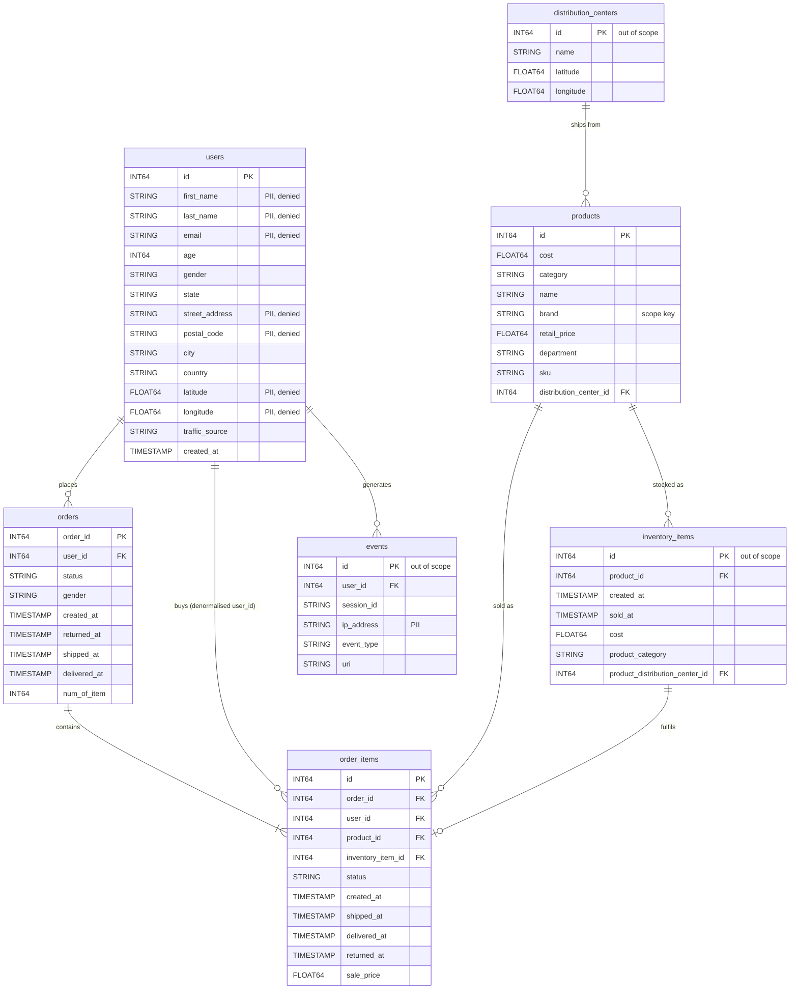
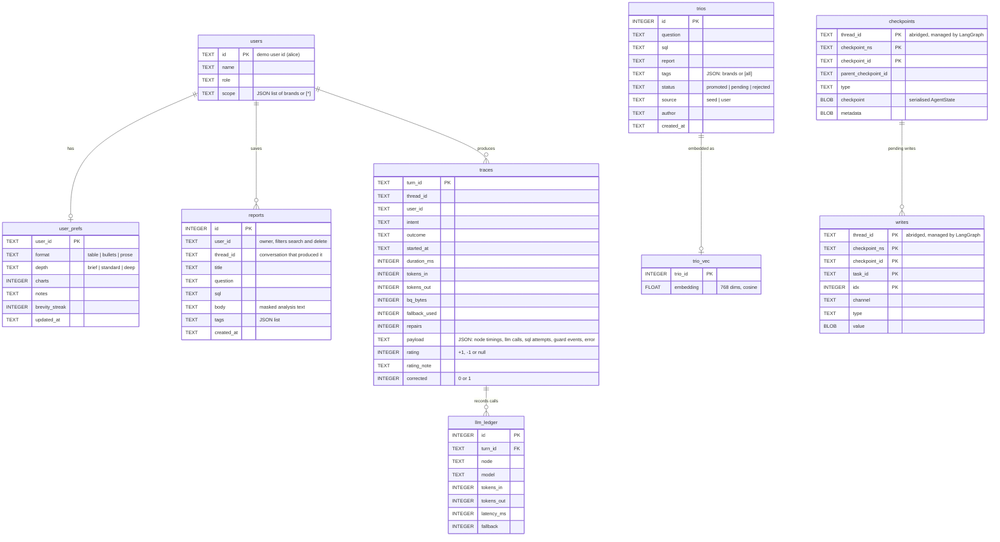

# Data model

Two data stores with two rules: the BigQuery dataset is read-only and queried through the
MCP tool server; the agent's own SQLite store is where everything the agent saves or learns
lives. This page describes both, the relationships between entities, and how the agent uses
each table.

Column names and types below are the ones the SQL guard and the prompts use
(`src/ria/guards/schema.py`). They match the public dataset as documented by Google;
`ria init` fetches the live schema from BigQuery and caches it in
`data/schema.json`, which takes precedence if the dataset changes.

## 1. The warehouse: `bigquery-public-data.thelook_ecommerce` (read-only)

theLook is a fictitious clothing retailer. The dataset has seven tables. The assignment
scopes the agent to four of them; the guard rejects queries on the other three by name.

### The four in-scope tables

| Table | One row per | Grain and notes |
|---|---|---|
| `users` | customer | Demographics (age, gender, state, city, country, traffic_source) may be used only in aggregates; see the demographics rules below. `created_at` is not a demographic column. Seven columns are personal identifiers and are denied by the SQL guard: `email`, `first_name`, `last_name`, `street_address`, `postal_code`, `latitude`, `longitude`. |
| `orders` | order | `status` is one of Cancelled, Processing, Shipped, Complete, Returned. `num_of_item` is the item count. `gender` is copied from the user. |
| `order_items` | item sold | The fact table. `sale_price` is the revenue per item. `status` repeats the order status per item. `user_id` is denormalised from `orders`, so order_items joins to users directly. `inventory_item_id` points at the physical unit (out of scope). |
| `products` | catalog product | `brand` is the scope key (`Settings.scope_column`, env `RIA_SCOPE_COLUMN`): a scoped user's brands are injected as `products.brand IN (...)`. `cost` vs `retail_price` gives margin. `department` is Men or Women. |

**Demographics rules** (SQL guard, every user including the CEO). The demographic columns
are `users.state`, `city`, `country`, `age`, `gender` and `traffic_source`, plus
`orders.gender` (copied from the user). A query that returns a customer, order or item
identifier (`users.id`, `order_items.user_id`, `orders.user_id`, `orders.order_id`,
`order_items.order_id`, `order_items.id`, `order_items.inventory_item_id`) in any select
list, outside `COUNT` or `APPROX_COUNT_DISTINCT`, and references a demographic column
anywhere in the query is rejected. A demographic column may appear bare in a select list
only in a SELECT that groups by it and reads a customer table (`GROUP BY ALL` is rejected).
That SELECT gets `HAVING COUNT(DISTINCT <customer id>) >= 10` (`min_group_size` in
`data/org_defaults.yaml`, read on every turn), so no group of fewer than 10 customers is shown.

### Relationships the agent relies on

| From | To | Cardinality | Used for |
|---|---|---|---|
| `order_items.order_id` | `orders.order_id` | many to one | order-level metrics (orders, AOV, status funnel) |
| `order_items.user_id` | `users.id` | many to one | customer metrics, demographics, churn proxy |
| `order_items.product_id` | `products.id` | many to one | category, brand, margin; the scope predicate |
| `orders.user_id` | `users.id` | many to one | signups vs orders |

The schema digest the model sees lists the first three as join keys. For a scoped user the
guard filters every SELECT that reads a dataset table to the user's brands:

- `products` in the SELECT: `<alias>.brand IN (...)` on every products alias (self-joins included).
- `order_items` in the SELECT: on every order_items alias,
  `<alias>.product_id IN (SELECT p.id FROM products AS p WHERE p.brand IN (...))`. No join is
  added, so the grain does not change.
- Only `orders` and/or `users`: a semi-join, `orders.order_id IN (...)` or `users.id IN (...)`
  over `order_items` joined to `products` and filtered to the user's brands. The outer
  query keeps its grain, so "signups per month" counts customers who bought one of the
  user's brands.

### Values worth knowing

- `orders.status` and `order_items.status`: Cancelled, Processing, Shipped, Complete, Returned.
  Revenue in the seed Trios excludes Cancelled and Returned.
- `users.traffic_source`: Facebook, Search, Email, Organic, Display.
- `products.department`: Men, Women. `products.category`: about 26 values (Jeans, Swim,
  Accessories, Tops & Tees, ...). `products.brand`: the scope key; the demo users own Levi's,
  Carhartt, Dockers and Wrangler (alice) and Columbia, Volcom, Quiksilver and Speedo (bob).
  `ria init` checks `data/users.yaml` against `SELECT DISTINCT brand` and warns about unknown
  brands.
- `events.event_type` (out of scope): home, department, product, cart, purchase, cancel.

### The three out-of-scope tables

`inventory_items` (one row per physical unit, with product attributes copied in),
`distribution_centers` (ten warehouses with coordinates), and `events` (web clickstream with
`ip_address`, session, browser, URI). The guard rejects them by name
(`table:rejected`). Adding one later means extending the allowlist, the PII column list
(`events.ip_address`), the schema digest, and the seed Trios.

## 2. The agent's own store: `ria.db` (SQLite with sqlite-vec)

| Table | Written by | Read by | Notes |
|---|---|---|---|
| `users` | `ria init` from `data/users.yaml` | `ria chat --user` | `scope` holds the YAML key `brands` as JSON. `["*"]` (the CEO) means unrestricted and is read back as `None`. |
| `user_prefs` | `update_memory` and `ack_preference` nodes | every prompt and the renderer | One row per user; created on first change. |
| `reports` | `save_report` via the MCP tool `reports_save` | `resolve_targets` and `list_reports` (`reports_search`), `show_report` (`reports_get`), `confirm_delete` (`reports_delete`) | Every read and delete is filtered by `user_id`, so only the author sees or deletes a report. Body is masked before storage. Deletion is a hard delete. |
| `trios` | `ria init` (seeds), `save_report` (pending candidates), `ria golden promote/reject` | `retrieve_trios` | Only `status = promoted` is retrievable. |
| `trio_vec` | `ria init` for any Trio without a vector | `TrioStore.search` (KNN, cosine) | sqlite-vec `vec0` virtual table; `trio_id` matches `trios.id`. |
| `traces`, `llm_ledger` | `write_trace` at the end of every graph turn; `rating` and `rating_note` by the `rating` node (`/good`, `/bad`); `corrected` by the router when it flags a correction | `ria trace`, `ria stats`, `ria eval` | One trace per turn; one ledger row per model call. A rating or correction updates the trace of the previous answer, not the current turn. |
| `checkpoints`, `writes` | LangGraph `AsyncSqliteSaver` after every node | resume, `--thread`, the delete confirmation | Managed by LangGraph; keyed by `thread_id`. The pending `interrupt()` lives here, and so does `last_turn_id` (below). |

Identifiers that tie the store together: `user_id` (who), `thread_id` (which conversation),
`turn_id` (which question). A saved report carries both `user_id` and `thread_id`, which is how
"delete the reports we made in this conversation" resolves.

`last_turn_id` is conversation state in the checkpoint, not a table column. `finalize` sets it
to the current `turn_id` when the turn's outcome is an answer (`ok`, `no_data`, `gave_up`,
`refused`, `error`, `saved`, `deleted`, `cancelled`) and the turn is not itself a rating.
`/good`, `/bad` and a router-detected correction update the `traces` row with that id.
`/reports`, `/report <id>`, `/schema` and `/help` do not change it.

## 3. Production mapping

| Prototype | Production |
|---|---|
| BigQuery public dataset, queried from your project | BigQuery with authorized views per brand set and a read-only service account |
| `trios` + `trio_vec` in SQLite | Trio bodies in a GCS bucket, embeddings in Vertex AI Vector Search |
| `reports`, `user_prefs`, `traces`, `llm_ledger` | Cloud SQL (Postgres) |
| `checkpoints`, `writes` | LangGraph Postgres checkpointer on Cloud SQL |
| `data/persona.md`, `data/org_defaults.yaml`, `data/persona_versions/` | versioned GCS objects; the persona behind an admin page that runs the persona gate, the org defaults written by the data team |

Two configuration files sit next to the store and are read on every turn, not loaded into
it. `data/org_defaults.yaml` holds `churn_window_days` (90), `revenue_statuses` (Complete,
Shipped, Processing) and `min_group_size` (10); it feeds the guard's HAVING threshold and
the "Business definitions" block in the SQL and analysis prompts from one source, and an
invalid file fails the turn with a message naming the key (or the file, for a YAML syntax error). `data/persona_versions/` (git-ignored)
receives the replaced `persona.md` on every `ria persona publish`, named by UTC timestamp,
so a persona change can be rolled back by publishing a saved version.
