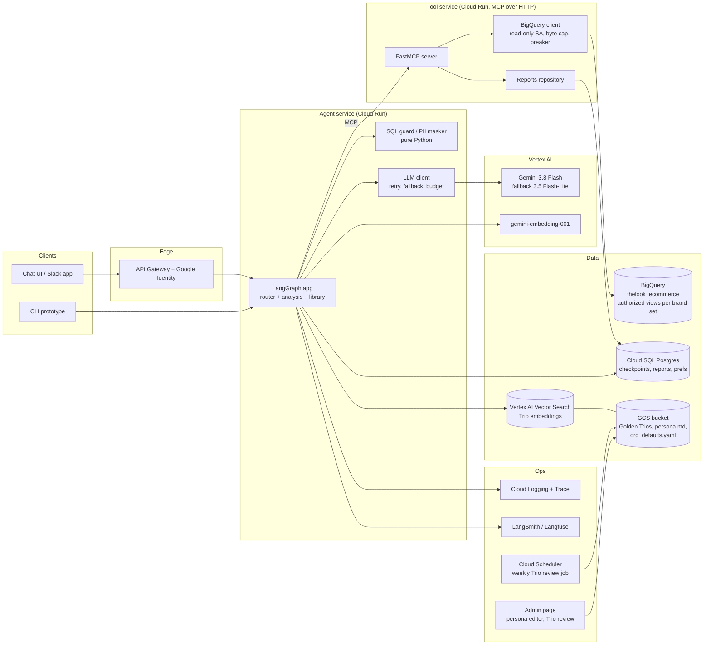
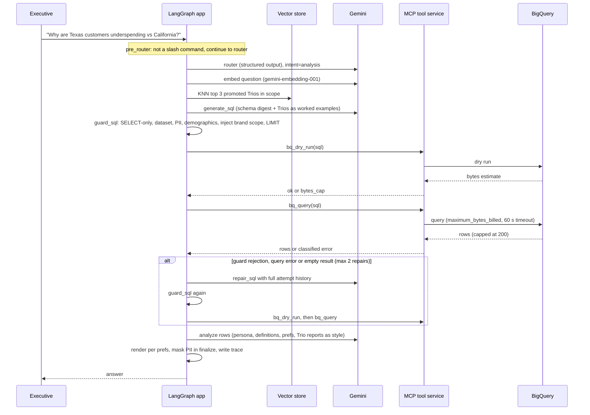
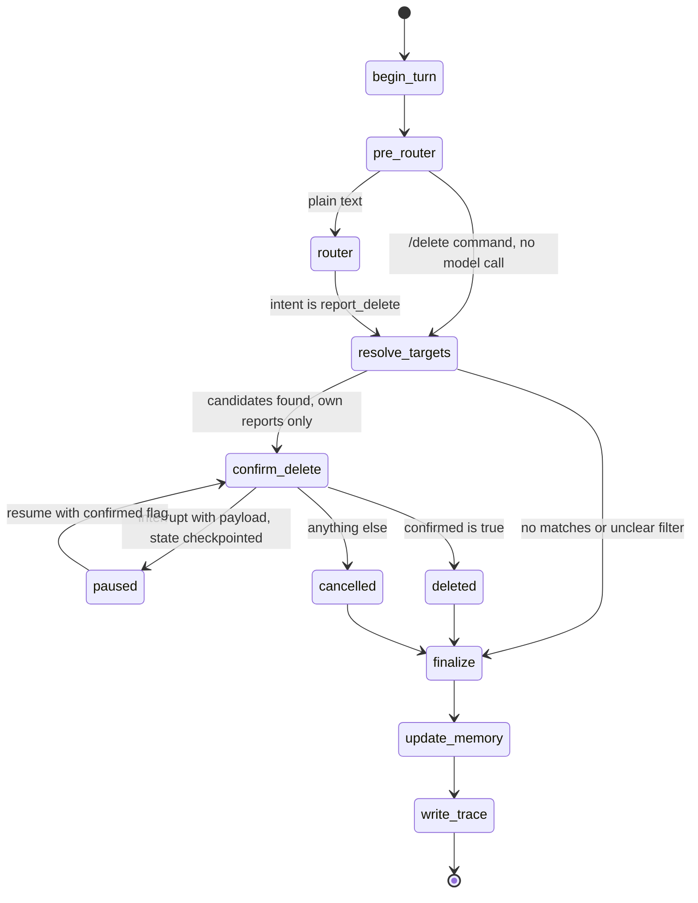

# High-Level Design: Retail Insights Agent

## 1. Purpose and scope

The Retail Insights Agent is a chat assistant for non-technical retail executives. They ask
questions about sales, products, customers, returns and delivery in plain English. The agent
writes BigQuery SQL over the public `bigquery-public-data.thelook_ecommerce` dataset, runs it
read-only, explains the result, and can save and delete reports. Each user sees only the
product brands assigned to them; the CEO sees everything. Personal columns (names, email,
address, postal code, coordinates) are never queried and never appear in the schema the
model sees. Demographics (state, city, country, age, gender, traffic source) appear only in
aggregates over at least 10 customers, never next to an individual customer. A regex
masker runs as a last pass on every answer, and saved report bodies and Trio candidates are
masked before storage.

This repository contains a runnable CLI prototype and this production design. The prototype
implements safety and PII masking, per-user brand scope, confirmation before report
deletion, resilience to model and warehouse failures (including slash commands that work
with no model), ratings and corrections on answers, and per-turn tracing. It also has thin
working versions of the Golden Bucket (retrieved example queries with a promotion command),
user preference memory, an evaluation runner, and a hot-reloaded persona file. Every Google
Cloud service in this document other than BigQuery is design only.

The technical detail for each assignment requirement is in
[technical-design.md](technical-design.md).

## 2. Production architecture (GCP)

How the prototype maps onto this picture:

| Production box | Prototype equivalent |
|---|---|
| Chat UI / Slack app, API Gateway, Google Identity | `ria chat --user <id>` with demo users from `data/users.yaml` |
| Agent service on Cloud Run | One local process: `src/ria/cli.py` builds the graph in `src/ria/graph/build.py` |
| Tool service, MCP over HTTP | `src/ria/mcp_server/server.py`, a FastMCP server the CLI spawns as a stdio subprocess (`src/ria/tools.py`) |
| BigQuery with authorized views | Direct read of the public dataset; scope enforced by SQL rewrite in `src/ria/guards/sql_guard.py` |
| Cloud SQL Postgres | One SQLite file, `ria.db` (`src/ria/db.py`), plus LangGraph's SQLite checkpointer |
| Vertex AI Vector Search | sqlite-vec `vec0` table `trio_vec` in the same SQLite file |
| GCS bucket of Trios, persona and org defaults | `data/golden_trios/*.yaml`, `data/persona.md` and `data/org_defaults.yaml` |
| Vertex AI Gemini | Gemini API (AI Studio key) through `langchain-google-genai` and `google-genai` |
| Cloud Logging, Trace, LangSmith | `traces` and `llm_ledger` tables, `traces.jsonl`, `ria trace`, `ria stats`; LangSmith if its env vars are set |
| Scheduler job and admin page | `ria golden list / promote / reject`; `ria persona check / publish`; editing `data/org_defaults.yaml` by hand |

The three logical subgraphs (router, analysis, library) are node groups inside one compiled
LangGraph `StateGraph` in the prototype (modules `graph/router.py`, `graph/analysis.py`,
`graph/library.py`, `graph/schema_qa.py`). A `pre_router` node (`graph/prerouter.py`) sits
in front of the router and sends slash commands straight to their nodes without a model
call. In production the graph stays one service; the part that would split
out is the tool service, which already sits behind the MCP boundary.

## 3. One analysis turn

Node names in the diagram are the real node names in `src/ria/graph/build.py`. A turn ends
with `finalize -> update_memory -> write_trace` on every graph path, including refusals,
give-ups, and model outages (`LLMUnavailable`, `BudgetExceeded`), so each of those turns
produces a trace row. Other exceptions escape the graph and are caught by the CLI loop
without a trace row; this is a known gap (see
[technical-design.md section 11](technical-design.md#11-error-handling-and-fallback-matrix)).

## 4. Report deletion with confirmation

`paused` is not a graph node. It is the state LangGraph keeps in the checkpointer between
the `interrupt()` call and the `Command(resume=...)` that continues the thread. Because it
lives in the checkpoint, a pending deletion survives a process restart. The `/delete`
command reaches the same `resolve_targets` node with the filter parsed in code, so deletion
with confirmation works with both models down. Deletion is a hard delete: OpsFleet confirmed
that the confirmation is the safeguard and no recovery window is needed.

## 5. Components and chosen services

| Component | Prototype | Production | Why |
|---|---|---|---|
| Chat surface | Terminal chat loop (prompt-toolkit + rich) | Web chat UI or Slack app | A chat thread keeps follow-up questions in context and needs no SQL or dashboard skills; the CLI runs with one command and no web server |
| Agent runtime | One local Python 3.12 process | Cloud Run service, min instances 1 | Stateless containers; all state is in the checkpointer and the database |
| Orchestration framework | LangGraph 1.x `StateGraph` with checkpointer | Same | Typed state, conditional edges, `interrupt()` for the delete confirmation, checkpoint per thread |
| LLM | Gemini 3.8 Flash, fallback Gemini 3.5 Flash-Lite, via Gemini API key | Same models on Vertex AI with provisioned throughput | Assignment prefers Gemini; Flash is cheap and supports structured output; fallback needs no second vendor |
| Embeddings | `gemini-embedding-001`, 768 dims, retrieval task types | Same on Vertex AI | Same vendor and key; 768 dims is enough for short questions |
| Vector store | sqlite-vec `vec0`, cosine distance | Vertex AI Vector Search (or BigQuery `VECTOR_SEARCH` at small scale) | Real KNN with no server locally; managed index with versioned deploys in production |
| Relational state | SQLite file `ria.db` | Cloud SQL for Postgres | Portable locally; Postgres has a LangGraph checkpointer and handles concurrent writers |
| Tool protocol | FastMCP over stdio, spawned by the CLI | FastMCP over streamable HTTP on its own Cloud Run service | Clear permission boundary; adding a capability means adding a tool |
| Data warehouse | BigQuery public dataset, read-only queries | BigQuery with authorized views per brand set | Dataset is given by the assignment; views move scope enforcement into IAM |
| Secrets | `.env` file (git-ignored) | Secret Manager mounted into Cloud Run | No keys in code or images |
| Tracing | SQLite `traces` + `llm_ledger`, `traces.jsonl`, optional LangSmith | Cloud Logging + Cloud Trace, LangSmith or Langfuse | Per-turn debugging locally; fleet-level alerting in production |
| Persona and org defaults storage | `data/persona.md` (published through `ria persona publish`, previous versions in `data/persona_versions/`) and `data/org_defaults.yaml`, both read every turn | Versioned GCS objects; the persona edited through an admin page that runs the same gate, the org defaults written by the data team | A business lead changes tone and the data team changes the churn and revenue definitions, neither with a deploy (section 7) |
| Trio review job | `ria golden list / promote / reject` | Weekly Cloud Scheduler job plus a reviewer page | A human approves every new example before it influences SQL |
| Identity | `--user` flag, users and their brands in `data/users.yaml` | Google Identity through API Gateway; groups map to brands | Identity drives scope; the prototype fakes only the login |

## 6. Data stores and what lives where

Column-level detail and the relationships between tables are in [data-model.md](data-model.md).

| Store | Purpose | Key columns or content | Production home |
|---|---|---|---|
| LangGraph checkpoint tables | Conversation state per `thread_id`, including a paused delete | Managed by `langgraph-checkpoint-sqlite` | Cloud SQL (Postgres checkpointer) |
| `users` | Demo identities, loaded from `data/users.yaml` by `ria init` | `id`, `name`, `role`, `scope` (JSON list of brands from the YAML key `brands`, `["*"]` = all) | Identity provider groups plus a brand mapping table |
| `user_prefs` | Long-term answer preferences | `user_id`, `format` (table/bullets/prose), `depth` (brief/standard/deep), `charts`, `notes`, `brevity_streak`, `updated_at` | Cloud SQL |
| `reports` | Saved reports library | `id`, `user_id`, `thread_id`, `title`, `question`, `sql`, `body`, `tags`, `created_at` | Cloud SQL |
| `trios` | Golden Trios and pending candidates | `id`, `question`, `sql`, `report`, `tags`, `status` (promoted/pending/rejected), `source` (seed/user), `author`, `created_at` | Trio documents in GCS, metadata in Cloud SQL |
| `trio_vec` | Embeddings of `trios.question` | `trio_id`, `embedding float[768]`, cosine distance | Vertex AI Vector Search index |
| `traces` | One row per turn | `turn_id`, `thread_id`, `user_id`, `intent`, `outcome`, `started_at`, `duration_ms`, `tokens_in`, `tokens_out`, `bq_bytes`, `fallback_used`, `repairs`, `payload` (JSON), `rating`, `rating_note`, `corrected` | Cloud Logging (structured) and BigQuery log sink |
| `llm_ledger` | One row per model call | `turn_id`, `node`, `model`, `tokens_in`, `tokens_out`, `latency_ms`, `fallback` | Same as traces |
| `traces.jsonl` | Append-only copy of each trace | Full trace as JSON | Replaced by Cloud Logging |
| `data/schema.json` | Live BigQuery schema cached by `ria init` | Column names and types for the four tables | Built at deploy time |
| `data/golden_trios/*.yaml` | 15 seed Trios | `question`, `sql`, `report`, `tags`, `author`, `created_at` | GCS bucket |
| `data/persona.md` | Tone and emphasis instructions | Free Markdown, at most 4000 characters | Versioned GCS object |
| `data/persona_versions/*.md` | Previous personas, one per publish | The replaced `persona.md`, named by UTC timestamp; git-ignored | GCS object versions |
| `data/org_defaults.yaml` | Org-wide business defaults | `churn_window_days` (90), `revenue_statuses` (Complete, Shipped, Processing), `min_group_size` (10) | Versioned GCS object |

## 7. Configuration layers

Four layers shape an answer. Each has one owner, one way to change it and one gate. A lower
layer never overrides a higher one: a user preference cannot change a definition, and a
persona cannot change scope.

| Layer | Owner | How it changes | Gate |
|---|---|---|---|
| Code: scope, safety rules, tool access, output language (English only) | Engineering | Pull request | Tests and the eval set |
| Org defaults: `data/org_defaults.yaml` (churn window, revenue statuses, minimum group size) | Data or admin team | Edit the YAML; read on every turn | Validated on load. An invalid file fails the turn with a message that names the problem; the turn is still traced |
| Persona: `data/persona.md` (tone and voice, emphasis, default format and depth wording, disclaimer line, report header) | Business or analytics lead | Edit a copy, then `ria persona check` and `ria persona publish` | Lint, plus the eval set with `--live` (zero deterministic failures, judge mean at least 4.0). No manual approval step, per OpsFleet |
| User preferences (format, depth, charts) | The user | Say it in chat | None; presentation only, never a definition |

The full table with validation ranges, the persona boundary and the persona lint rules are
in [technical-design.md section 8](technical-design.md#8-persona-management) and
[section 6](technical-design.md#6-quality-assurance).

## 8. Extension points

New capabilities are new MCP tools plus, where the user triggers them by asking, a new router
intent. The SQL guard, PII masker and scope rules do not change, because none of these tools
issues SQL on the model's behalf.

- **Charts**: a `render_chart` tool takes the result rows and a chart spec, renders a PNG
  server-side, stores it in GCS and returns a signed URL. `render` would call it when the
  user's `charts` preference is on. The preference is already stored today; nothing reads it
  yet.
- **Email**: a `send_report` tool sends a saved report to an address list. Sending data out of
  the system is high-stakes, so it goes behind a second `interrupt()` confirmation, built the
  same way as the delete flow, and recipients are restricted to the company domain.
- **Web trends**: a `web_search` tool with a domain allowlist adds outside context (for
  example, seasonal trends) to `analyze`. Results are passed to the model as quoted data, not
  as instructions.

## 9. Non-functional

**Latency budget per analysis turn** (design targets, not measured on a live run):

| Step | Target |
|---|---|
| Router call (Flash, structured output) | 1 s |
| Query embedding + KNN | 0.5 s |
| SQL generation | 2 to 3 s |
| Guard + dry run | 0.5 s |
| BigQuery query on this dataset | 2 to 5 s |
| Analysis call | 3 to 5 s |
| Render, mask, trace | under 0.1 s |
| **Typical total** | **10 to 15 s; p95 target 20 s** |

Each repair adds one model call and one query, about 5 s. The prototype records the actual
numbers per turn; `ria stats` reports p50 and p95.

**Cost per turn.** An analysis turn makes 3 generation calls (router, SQL, analysis), plus up
to 2 repairs, plus 1 embedding call. Inputs are dominated by the schema digest, three Trios
and the persona; outputs are short (a SQL statement, an answer of a few hundred words). Cost
per turn is `sum(tokens_in x input price + tokens_out x output price)` over the calls in
`llm_ledger`, plus BigQuery bytes scanned at on-demand pricing. `ria stats` prints mean tokens
and mean bytes per turn, which are the inputs to this formula. The 1 GB byte cap bounds the
BigQuery part of any single query.

**Concurrency.** Cloud Run instances serve several conversations at once because the graph
keeps no in-process state between turns. The checkpointer and reports move to Postgres for
concurrent writers. The limiting resource is Gemini quota, which is why production uses
provisioned throughput.

**Failure domains.**

| Dependency down | Behaviour |
|---|---|
| Gemini primary model | 3 attempts with backoff, then the fallback model; primary skipped for 60 s afterwards |
| Both Gemini models | Free-text turns end with "The language model is unavailable right now..."; the trace records the error. Slash commands (`/reports`, `/report <id>`, `/delete <filter>` with its confirmation, `/schema`, `/good`, `/bad`, `/help`) keep working because `pre_router` handles them with no model call. `begin_turn` skips history summarisation instead of failing the turn. |
| BigQuery | Classified error; after 3 failures the circuit opens for 5 minutes and the agent says the data source is unavailable; schema questions, saving and deleting reports, and all slash commands keep working |
| BigQuery and both Gemini models | Same as both models down: slash commands work (none of them queries BigQuery; `/schema` uses the schema cached at `ria init`), free text gets the model-unavailable message |
| Vector store | Production: analysis continues without worked examples (lower SQL quality, still guarded). Prototype: the store is in the local SQLite file, so it fails only with the database |
| Embedding API | The `retrieve_trios` node catches the exception and the turn continues without examples; a `retrieval:failed:<ExceptionType>` guard event is recorded in the trace |
| Tool service | Prototype: the turn ends with "Something went wrong: ..." and writes no trace row (known gap; see [technical-design.md section 11](technical-design.md#11-error-handling-and-fallback-matrix)). Production: the tool service is a Cloud Run service with health checks and the agent retries once |

**Outage visibility.** OpsFleet wants both users and the ops team to know when the agent is
fully down, and a disclosed fallback. Users get a clear message and a note after any answer
from the backup model, and `ria stats` reports `outage_turns` for the ops team. The exact
messages, the note, what `outage_turns` counts and the degraded mode are in
[technical-design.md section 5](technical-design.md#5-resilience).

Ops alert (design). Page the on-call when 3 or more consecutive outage turns occur within
5 minutes, or when the fallback rate over 15 minutes exceeds 50 percent. In production
both come from the trace log sink in BigQuery; in the prototype `ria stats --since` gives
the same numbers by hand.
